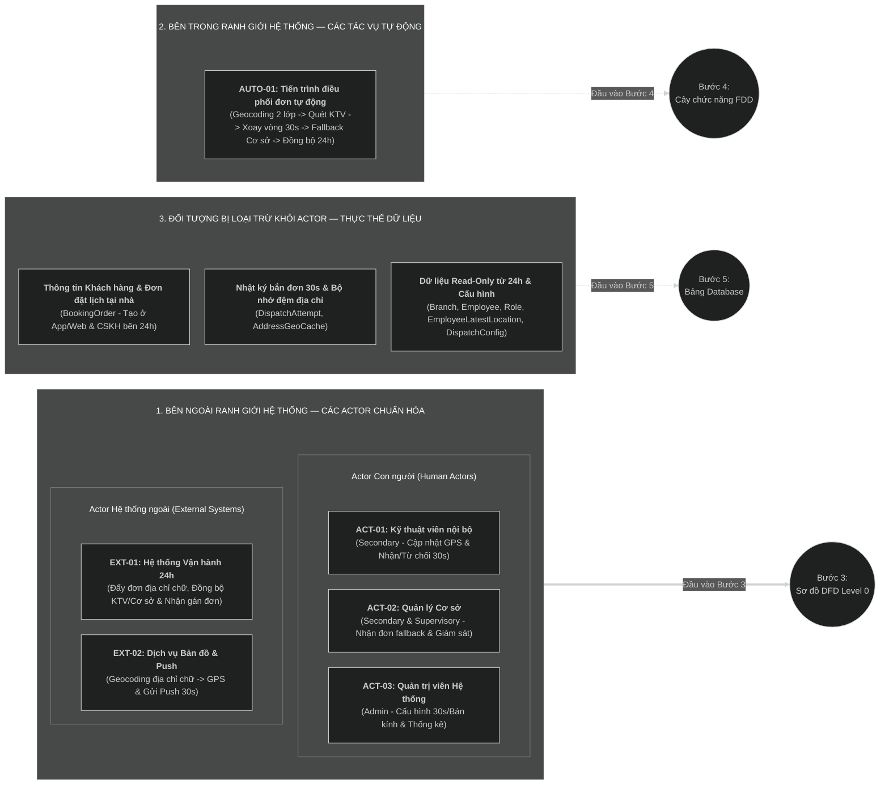

# BƯỚC 2: TRUY VẾT & BÓC TÁCH TÁC NHÂN (7 CÂU HỎI TRUY VẾT ACTOR)

> **Đầu vào:** [Bước 1 — Khảo sát & Hiểu bài toán (`md/analysis/1-problem-survey.md`)](./1-problem-survey.md)
> **Chuẩn áp dụng:** [2_actor_identification_7_questions.md](../../.agents/rules/2-analysis/2_actor_identification_7_questions.md) & [SystemsThinking.md](../../.agents/rules/2-analysis/SystemsThinking.md)
> **Mục đích:** Quét toàn bộ kết quả Bước 1 qua 7 câu hỏi truy vết và 4 quy tắc chuẩn hóa để chốt **Bảng 1 (Actor chuẩn hóa ➔ Đầu vào Bước 3 DFD Level 0)**, **Bảng 2 (Tác vụ tự động chạy ngầm ➔ Đầu vào Bước 4 FDD)** và **Thực thể dữ liệu bị loại trừ (➔ Đầu vào Bước 5 Database)**.

---

## 1. Bảy Câu hỏi Truy vết Actor (Từ kết quả Bước 1)

| Thứ tự | Câu hỏi truy vết Actor | Nguồn ánh xạ từ Bước 1 (`1-problem-survey.md`) | Kết quả Truy vết Đã Chốt (`[Đã xác nhận]`) |
|:---:|---|---|---|
| **Câu 1** | **Ai trực tiếp đưa dữ liệu mới vào hệ thống?** *(Primary Actor)* | • **Câu 2** (App/Web & CSKH tạo đơn trên 24h) • **Câu 4 & `DEC-01`** | **Hệ thống Vận hành 24h hiện hữu (`EXT-01`):** Là tác nhân duy nhất gọi API đẩy 100% đơn đặt lịch tại nhà mới (kèm địa chỉ chữ của khách hàng) sang phân hệ Điều phối. |
| **Câu 2** | **Ai tiếp nhận, duyệt hoặc xử lý bước tiếp theo?** *(Secondary Actor)* | • **Câu 3** (`OBJ-01`, `OBJ-03`) • **Câu 4** (KTV nội bộ, Quản lý Cơ sở) | 1. **Kỹ thuật viên nội bộ (`ACT-01`):** Cập nhật vị trí GPS/trạng thái sẵn sàng trên app nội bộ, nhận thông báo đơn mới và bấm **Nhận đơn** hoặc **Từ chối** trong vòng **30 giây**. 2. **Quản lý Cơ sở (`ACT-02`):** Nhận thông báo và tiếp nhận xử lý các đơn **tự động chuyển về Cơ sở** (do hết KTV không ai nhận hoặc do địa chỉ không phân giải được GPS). |
| **Câu 3** | **Ai xem báo cáo, giám sát và ra quyết định?** *(Supervisory Actor)* | • **Câu 4** (Quản lý Cơ sở, Quản trị viên) • **Câu 5** (`OBJ-04`) | • **Quản lý Cơ sở (`ACT-02`):** Giám sát danh sách đơn fallback, đơn đang điều phối và vị trí KTV trực thuộc Cơ sở trên bản đồ. • **Quản trị viên Hệ thống (`ACT-03`):** Giám sát nhật ký điều phối và xem báo cáo thống kê tỷ lệ nhận đơn/quá hạn 30s/fallback toàn hệ thống. |
| **Câu 4** | **Khách hàng / Người dùng cuối tương tác trực tiếp hay gián tiếp?** *(Self-service User vs Data Entity)* | • **Câu 2** (Kênh App/Web & FB/Zalo/Hotline/Caresoft) • **Câu 4 & `DEC-01`** | **Tương tác GIÁN TIẾP 100%:** Khách hàng đặt lịch ở App/Web hoặc qua CSKH (FB/Zalo/Hotline/Caresoft) bên **Hệ thống 24h**, không đăng nhập hay thao tác trực tiếp vào phân hệ Điều phối ➔ **Loại cả Khách hàng và CSKH khỏi Actor**, chuyển thành thông tin dữ liệu thuộc thực thể `BookingOrder`. |
| **Câu 5** | **Hệ thống có trao đổi dữ liệu tự động với bên thứ 3 nào không?** *(External System Actor)* | • **Câu 1** (`In-Scope` & `DEC-02`, `DEC-03`) • **Câu 5** (`OBJ-02`, `OBJ-04`) | Có **2 Hệ thống ngoài (`External Systems`)**: 1. **Hệ thống Vận hành 24h hiện hữu (`EXT-01`):** Đẩy đơn đặt lịch tại nhà mới sang; đồng bộ dữ liệu nguồn `read-only` (Cơ sở, KTV, Phân quyền, Vị trí nhân viên); và nhận bàn giao kết quả gán đơn. 2. **Dịch vụ Bản đồ & Thông báo đẩy (`EXT-02`):** Thực hiện **Geocoding API** chuyển đổi địa chỉ bằng chữ sang tọa độ `(lat, lng)` và bắn **Push Notification 30s** tới thiết bị KTV / Cơ sở. |
| **Câu 6** | **Có nghiệp vụ nào tự động chạy ngầm theo thời gian/hàng đợi không?** *(Automated Process / Background Job)* | • **Câu 3** (`OBJ-02`, `OBJ-03`) • **Câu 5 & `DEC-02`, `DEC-04`** | Gộp thành **1 Tác vụ tự động duy nhất (`AUTO-01`) — Tiến trình điều phối đơn tự động**: xử lý trọn gói từ lúc **Geocoding địa chỉ chữ 2 lớp (+ Fallback Cơ sở nếu mờ)** ➔ **Quét vị trí KTV trong bán kính (gần đến xa)** ➔ **Đếm ngược xoay vòng 30s/người (`KTV A ➔ KTV B`)** ➔ **Chuyển về Cơ sở gần nhất nếu không ai nhận** ➔ **Đồng bộ kết quả sang Hệ thống 24h**. |
| **Câu 7** | **Ai quản trị tài khoản, phân quyền và cấu hình nền tảng?** *(System Admin)* | • **Câu 4** (Quản trị viên) • **Bước 1 (`DEC-03`, `DEC-05`)** | **Quản trị viên Hệ thống (`ACT-03`):** Chỉ cấu hình các **tham số điều phối động** (bán kính quét GPS, thời gian đếm ngược 30s, độ trễ GPS tối đa cho phép); còn **tài khoản KTV, phân quyền và danh sách Cơ sở đều chỉ đọc (`read-only`)** từ Hệ thống 24h (`EXT-01`). |

---

## 2. Áp dụng 4 Quy tắc Chuẩn hóa & Loại trừ Sai lầm

1. **Quy tắc 1 — Gộp chức danh trùng quyền:**
   - Gộp các nhân sự điều phối/trực cơ sở có cùng quyền tiếp nhận đơn fallback và xem bản đồ KTV cơ sở thành 1 Actor duy nhất: `ACT-02 (Quản lý Cơ sở)`.
2. **Quy tắc 2 — Phân biệt Actor vs. Data Entity:**
   - **Loại Khách hàng & Nhân viên CSKH/Tổng đài khỏi Actor:** Vì toàn bộ thao tác đặt lịch và tạo đơn diễn ra bên App/Web hoặc Hệ thống 24h rồi mới đẩy API sang phân hệ Điều phối. Thông tin khách hàng (`customer_name`, `customer_phone`, `customer_address`, `district`, `source_channel`) được lưu thành trường dữ liệu trong bảng **Đơn đặt lịch (`BookingOrder`)**.
   - Các bảng đồng bộ `read-only` từ 24h (`Branch`, `Employee`, `Role`, `EmployeeLatestLocation`) và bảng bộ nhớ đệm địa chỉ (`AddressGeoCache`) là **Thực thể dữ liệu (`Entity`)** cho Bước 5.
3. **Quy tắc 3 — Loại bỏ Hệ thống ngoài giả định:**
   - Chỉ giữ lại đúng 2 hệ thống giao tiếp tự động qua API/Push: `EXT-01 (Hệ thống Vận hành 24h hiện hữu)` và `EXT-02 (Dịch vụ Bản đồ Geocoding & Push Notification)`. Các Website vệ tinh, FB, Zalo, Caresoft không kết nối trực tiếp với phân hệ Điều phối mà đi qua `EXT-01`.
4. **Quy tắc 4 — Tác vụ tự động KHÔNG phải là Actor:**
   - **`AUTO-01` (Tiến trình điều phối đơn tự động)** chạy ngầm bên trong ranh giới hệ thống nên tách riêng vào **Bảng 2**, không vẽ lên sơ đồ DFD Level 0 ở Bước 3, và bắt buộc đưa vào cây chức năng FDD ở Bước 4.

---

## 3. Danh sách Chuẩn hóa (Đầu vào Bước 3, Bước 4 và Bước 5)

### Bảng 1: Danh sách Actor Chuẩn hóa *(Bên ngoài Ranh giới Hệ thống ➔ Đầu vào Bước 3 DFD Level 0)*

| Mã Actor | Tên Actor chuẩn hóa | Nhóm phân loại | Vai trò & Phạm vi Tương tác Chính với Hệ thống |
|:---:|---|---|---|
| **`ACT-01`** | **Kỹ thuật viên nội bộ** | Actor Con người (`Secondary`) | Cập nhật vị trí GPS và trạng thái sẵn sàng nhận đơn trên app nội bộ; nhận thông báo đẩy đơn mới và phản hồi **Nhận đơn** hoặc **Từ chối** trong vòng **30 giây**. |
| **`ACT-02`** | **Quản lý Cơ sở** | Actor Con người (`Secondary & Supervisory`) | Nhận thông báo và tiếp nhận xử lý các đơn **tự động chuyển về Cơ sở** (do hết lượt KTV hoặc không phân giải được tọa độ); giám sát đơn và vị trí KTV trực thuộc Cơ sở trên bản đồ. |
| **`ACT-03`** | **Quản trị viên Hệ thống** | Actor Con người (`System Admin & Supervisory`) | Cấu hình tham số điều phối động (bán kính quét GPS, thời gian đếm ngược 30s, độ trễ GPS tối đa); xem nhật ký điều phối và báo cáo thống kê toàn hệ thống *(tài khoản, phân quyền, danh sách Cơ sở đọc `read-only` từ `EXT-01`)*. |
| **`EXT-01`** | **Hệ thống Vận hành 24h hiện hữu** | Actor Hệ thống ngoài (`Primary & External System`) | Đẩy đơn đặt lịch tại nhà mới (kèm địa chỉ bằng chữ) sang phân hệ Điều phối; đồng bộ dữ liệu nguồn `read-only` (Cơ sở, KTV, Phân quyền, Vị trí nhân viên); nhận bàn giao kết quả gán đơn (KTV hoặc Cơ sở) để xử lý tiếp nghiệp vụ phía sau. |
| **`EXT-02`** | **Dịch vụ Bản đồ (Geocoding) & Thông báo đẩy (Push)** | Actor Hệ thống ngoài (`External System`) | Nhận địa chỉ chữ để phân giải ra tọa độ GPS `(lat, lng)` (`Geocoding API`); thực thi gửi Push Notification 30s tới thiết bị của KTV và Quản lý Cơ sở. |

### Bảng 2: Danh sách Tác vụ Tự động Chạy ngầm *(Bên trong Ranh giới Hệ thống ➔ Đầu vào Bước 4 FDD)*

| Mã Tác vụ | Tên Tác vụ Tự động (`Queue / Worker`) | Cơ chế Kích hoạt & Logic Xử lý Lõi |
|:---:|---|---|
| **`AUTO-01`** | **Tiến trình điều phối đơn tự động** | Tự động kích hoạt ngay khi nhận đơn mới từ `EXT-01`: 1. **Geocoding 2 lớp:** Kiểm tra tọa độ sẵn có hoặc tra cứu `AddressGeoCache`; nếu chưa có thì gọi `EXT-02` (`Geocoding API`) để đổi **địa chỉ bằng chữ** sang `(lat, lng)` (nếu địa chỉ quá mơ hồ không xác định được tọa độ tin cậy ➔ chuyển thẳng đơn về Cơ sở theo Quận/Huyện). 2. **Quét & Xếp hạng KTV:** Lọc KTV nội bộ đang sẵn sàng trong bán kính cấu hình, xếp hạng từ gần đến xa theo vị trí mới nhất. 3. **Xoay vòng 30 giây:** Bắn Push Notification tuần tự từng KTV với bộ đếm **30 giây/người** (`KTV A ➔ KTV B`); thu hồi lượt nếu quá 30s hoặc KTV từ chối. 4. **Fallback & Đồng bộ 24h:** Nếu không ai nhận ➔ tự động gán đơn về Cơ sở gần nhất và phát thông báo cho `ACT-02`; cuối cùng đồng bộ kết quả gán đơn sang `EXT-01`. |

---

## 4. Sơ đồ Phân loại Actor & Ranh giới Hệ thống

---

> **Đầu ra chuyển tiếp sang Bước 3:** Toàn bộ 5 Actor trong **Bảng 1** (`ACT-01`..`ACT-03`, `EXT-01`, `EXT-02`) là nguồn duy nhất được đưa lên **Sơ đồ Ngữ cảnh DFD Level 0 (`md/analysis/3-dfd-context-diagram.md`)**. Riêng **`AUTO-01` (Bảng 2)** được giữ lại để chuyển thẳng vào **Bước 4 (`md/analysis/4-fdd-and-rbac.md`)**.
