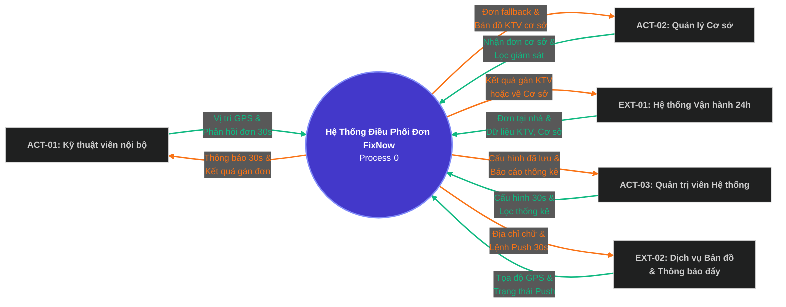

# BƯỚC 3: THIẾT KẾ SƠ ĐỒ NGỮ CẢNH (DFD LEVEL 0)

> **Đầu vào:** [Bước 2 — Truy vết & Bóc tách Tác nhân (`md/analysis/2-actor-identification.md`)](./2-actor-identification.md)
> **Chuẩn áp dụng:** [3_dfd_level_0_standard.md](../../.agents/rules/2-analysis/3_dfd_level_0_standard.md) & [SystemsThinking.md](../../.agents/rules/2-analysis/SystemsThinking.md)
> **Mục đích:** Mô hình hóa hệ thống theo nguyên tắc Hộp đen Yourdon–DeMarco (`Process 0`), xác định đầy đủ các cặp luồng dữ liệu **Input / Output** với 5 Actor chuẩn hóa từ Bảng 1 của Bước 2 và lập **Bảng Đặc tả 5 Cột** làm đầu vào trực tiếp cho **Bước 4 (FDD & RBAC)** và **Bước 5 (Database)**.

---

## 1. Nguyên tắc Hộp đen (Yourdon–DeMarco) & Quy ước Biểu diễn

1. **Hộp đen duy nhất (`Process 0`):** Toàn bộ phân hệ Tiếp nhận đơn từ 24h ➔ Tự động Geocoding địa chỉ chữ + Fallback ➔ Điều phối bắn đơn GPS xoay vòng 30 giây ➔ Chuyển về Cơ sở được biểu diễn bằng 1 khối tròn trung tâm duy nhất **`Hệ Thống Điều Phối Đơn FixNow (Process 0)`** — tuyệt đối không vẽ bảng Database hay phân hệ con bên trong sơ đồ.
2. **Đúng 5 Actor từ Bảng 1 của Bước 2:**
   - **3 Actor Con người:** `ACT-01 (Kỹ thuật viên nội bộ)`, `ACT-02 (Quản lý Cơ sở)`, `ACT-03 (Quản trị viên Hệ thống)`.
   - **2 Actor Hệ thống ngoài:** `EXT-01 (Hệ thống Vận hành 24h hiện hữu)`, `EXT-02 (Dịch vụ Bản đồ Geocoding & Thông báo đẩy)`.
   - **Loại trừ:** Khách hàng & CSKH (tương tác gián tiếp qua `EXT-01`) không phải Actor; tác vụ chạy ngầm `AUTO-01` nằm bên trong hộp đen nên **không vẽ trên sơ đồ DFD Level 0** (sẽ đưa vào cây FDD ở Bước 4).
3. **Quy ước luồng dữ liệu:**
   - **Mũi tên màu xanh lá (`#10b981`):** Luồng dữ liệu đầu vào (**Input** — Actor gửi vào Hệ thống).
   - **Mũi tên màu cam (`#f97316`):** Luồng dữ liệu đầu ra (**Output** — Hệ thống trả về Actor).
   - **Định danh mã hành động trong Bảng 5 cột:** Theo đúng cú pháp `[Tên vai trò - STT]`.

---

## 2. Sơ đồ Ngữ cảnh DFD Level 0

---

## 3. Bảng Đặc tả Actor - Hành động 5 Cột (14 Hành động)

| Actor | Mã | Hành động | Dữ liệu Input (Actor gửi vào) | Dữ liệu Output (Actor nhận lại) |
|---|---|---|---|---|
| **ACT-01: Kỹ thuật viên nội bộ** | `[Kỹ thuật viên - 01]` | Đăng nhập hệ thống | Tên đăng nhập / Số điện thoại nội bộ, mật khẩu, Device Push Token. | Access Token, Refresh Token, thông tin hồ sơ KTV, mã cơ sở trực thuộc và quyền hạn. |
| **ACT-01: Kỹ thuật viên nội bộ** | `[Kỹ thuật viên - 02]` | Cập nhật vị trí GPS & trạng thái sẵn sàng | Tọa độ GPS hiện tại (`lat`, `lng`), thời gian ghi nhận (`recorded_at`), trạng thái sẵn sàng nhận đơn (`is_available`). | Xác nhận cập nhật vị trí/trạng thái thành công, trạng thái hoạt động hiện tại của KTV. |
| **ACT-01: Kỹ thuật viên nội bộ** | `[Kỹ thuật viên - 03]` | Phản hồi lượt bắn đơn trong 30 giây | Mã lượt bắn đơn (`dispatch_attempt_id`), mã đơn (`booking_id`), quyết định (`accept` / `reject`), lý do từ chối (nếu có). | Kết quả xác nhận: nếu nhận hợp lệ trong 30s ➔ trả chi tiết thông tin đơn & địa chỉ khách; nếu hết hạn/đã khóa ➔ trả thông báo hết lượt. |
| **ACT-02: Quản lý Cơ sở** | `[Quản lý cơ sở - 01]` | Đăng nhập hệ thống | Tên đăng nhập / Số điện thoại nội bộ, mật khẩu. | Access Token, Refresh Token, thông tin tài khoản, phạm vi cơ sở phụ trách (`branch_id`) và quyền hạn. |
| **ACT-02: Quản lý Cơ sở** | `[Quản lý cơ sở - 02]` | Tiếp nhận đơn tự động chuyển về Cơ sở | Mã đơn fallback (`booking_id`), thao tác xác nhận tiếp nhận hoặc ghi chú xử lý tại cơ sở. | Trạng thái đơn đã tiếp nhận tại Cơ sở, thông tin chi tiết khách hàng, lý do fallback *(hết KTV / lỗi Geocoding)* & lịch sử bắn 30s trước đó. |
| **ACT-02: Quản lý Cơ sở** | `[Quản lý cơ sở - 03]` | Giám sát đơn & vị trí KTV thuộc Cơ sở | Bộ lọc cơ sở (`branch_id`), trạng thái đơn, trạng thái trực KTV, khoảng ngày (`from_date`, `to_date`), phân trang. | Danh sách đơn đang điều phối/fallback thuộc cơ sở, vị trí GPS các KTV trực thuộc trên bản đồ và nhật ký lượt bắn 30s. |
| **ACT-03: Quản trị viên Hệ thống** | `[Quản trị viên - 01]` | Đăng nhập hệ thống | Tên đăng nhập, mật khẩu. | Access Token, Refresh Token, thông tin tài khoản Admin và danh sách quyền. |
| **ACT-03: Quản trị viên Hệ thống** | `[Quản trị viên - 02]` | Cấu hình tham số điều phối động | Bán kính quét GPS mặc định (`radius_km`), thời gian đếm ngược mỗi lượt (`timeout_seconds = 30`), độ trễ GPS tối đa (`gps_ttl_minutes`), ngưỡng fallback Geocoding. | Bản ghi cấu hình tham số điều phối mới nhất đã được lưu và áp dụng. |
| **ACT-03: Quản trị viên Hệ thống** | `[Quản trị viên - 03]` | Giám sát điều phối & xem thống kê toàn hệ thống | Khoảng ngày (`from_date`, `to_date`), mã cơ sở (`branch_id`), trạng thái Geocoding/điều phối, phân trang nhật ký. | Số liệu thống kê (tổng đơn, tỷ lệ Geocoding thành công, tỷ lệ KTV nhận/quá hạn 30s, tỷ lệ đơn fallback về Cơ sở) và bảng nhật ký chi tiết. |
| **EXT-01: Hệ thống Vận hành 24h** | `[Hệ thống 24h - 01]` | Đẩy đơn đặt lịch tại nhà mới cần điều phối | API Key/Signature xác thực, mã đơn 24h (`external_order_id`), kênh phát sinh (`app`/`web`/`fb`/`zalo`/`hotline`/`caresoft`), tên/SĐT khách, **địa chỉ bằng chữ** (`address`, `ward`, `district`, `province`), tọa độ tùy chọn nếu có (`lat`, `lng`), mô tả sự cố. | Xác nhận tiếp nhận đơn (`201 Created` / `202 Accepted`), mã đơn điều phối nội bộ (`booking_code`) và trạng thái bắt đầu xử lý. |
| **EXT-01: Hệ thống Vận hành 24h** | `[Hệ thống 24h - 02]` | Đồng bộ dữ liệu nguồn `read-only` (Cơ sở, KTV, Phân quyền, Vị trí) | Payload danh sách Cơ sở (`branch`), nhân sự KTV (`employee`), vai trò/quyền (`role`) và vị trí GPS nhân viên mới nhất (`lat`, `lng`, `updated_at`). | Trạng thái đồng bộ thành công, số bản ghi đã cập nhật và log lỗi đồng bộ (nếu có). |
| **EXT-01: Hệ thống Vận hành 24h** | `[Hệ thống 24h - 03]` | Nhận bàn giao kết quả gán đơn (KTV hoặc Cơ sở) | Mã đơn tham chiếu (`external_order_id`, `booking_code`), trạng thái xác nhận nhận Webhook/API từ phía hệ thống 24h. | Kết quả điều phối hoàn chỉnh: loại kết quả (`assigned_ktv` / `fallback_branch`), mã KTV hoặc mã Cơ sở tiếp nhận, tọa độ đã phân giải và lịch sử các lượt bắn 30s. |
| **EXT-02: Dịch vụ Bản đồ & Thông báo đẩy** | `[Dịch vụ Bản đồ/Push - 01]` | Phân giải địa chỉ chữ sang tọa độ GPS (Geocoding) | Chuỗi địa chỉ chuẩn hóa gửi đi (`address`, `ward`, `district`, `province`). | Tọa độ GPS trả về (`lat`, `lng`), mức độ chính xác (`accuracy_level`) hoặc trạng thái không phân giải được (`unresolved`). |
| **EXT-02: Dịch vụ Bản đồ & Thông báo đẩy** | `[Dịch vụ Bản đồ/Push - 02]` | Gửi thông báo đẩy 30s (Push Notification) | Device Token của KTV hoặc Quản lý Cơ sở, tiêu đề/nội dung thông báo, mã đơn, thời hạn đếm ngược 30s. | Trạng thái giao nhận thông báo đẩy (`sent` / `failed`, message ID). |

---

## 4. Tổng hợp Hành động Trùng lặp (Chuẩn bị cho Công thức Bảo toàn Bước 4)

Theo công thức tại [4_fdd_and_rbac_standard.md](../../.agents/rules/2-analysis/4_fdd_and_rbac_standard.md):
> **Tổng Chức năng Cấp 2 = Tổng Hành động Actor (Bước 3) − Số Hành động trùng giữa các Actor + Số Tác vụ tự động (Bước 2)**

Hiện tại Bảng Đặc tả 5 Cột có **14 hành động Actor** và Bước 2 có **1 tác vụ tự động (`AUTO-01`)**. Nhóm hành động trùng lặp giữa nhiều Actor sẽ được hợp nhất ở **Bước 4**:

| Nhóm hành động trùng lặp | Các mã hành động ở Bước 3 | Dự kiến hợp nhất tại Bước 4 (FDD) |
|---|---|---|
| **Đăng nhập & Phiên xác thực** | `[Kỹ thuật viên - 01]`, `[Quản lý cơ sở - 01]`, `[Quản trị viên - 01]` *(3 hành động)* | Hợp nhất thành **1 chức năng** *(Xác thực & Quản lý phiên đăng nhập)* ➔ Giảm **2** hành động trùng. |

---

> **Đầu ra chuyển tiếp sang Bước 4:** Toàn bộ **14 hành động** trong Bảng 5 Cột cùng **Dữ liệu Input / Output** tương ứng (kết hợp với Tác vụ tự động `AUTO-01` từ Bước 2) là nguyên liệu trực tiếp để xây dựng **Cây Phân rã Chức năng FDD 3 Cấp (nhịp IPO)** và **Ma trận RBAC** tại **Bước 4 (`md/analysis/4-fdd-and-rbac.md`)**.
