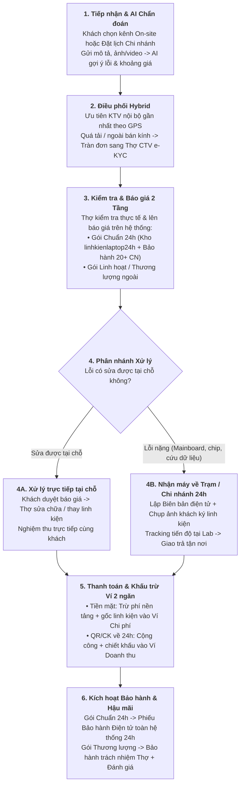

# BƯỚC 0 — YÊU CẦU GỐC HỆ THỐNG: PROJECT-FIXNOW

> **Tài liệu nguồn (Bước 0):** Nền tảng Điều phối Dịch vụ Kỹ thuật & Cung ứng Linh kiện O2O cho hệ sinh thái **24h Group** (`suachualaptop24h.com` & `linhkienlaptop24h.com`).
> **Trạng thái:** `[Đã xác nhận phạm vi cốt lõi]` — Sẵn sàng làm đầu vào cho **Bước 1: Khảo sát & Hiểu bài toán (`md/analysis/1-problem-survey.md`)**.

---

## 1. Tổng quan Dự án & Định vị Chiến lược (Project Overview & Strategic Positioning)

### 1.1. Định vị Sản phẩm
**Project-FixNow** là **Nền tảng Điều phối Dịch vụ Kỹ thuật & Cung ứng Linh kiện O2O (On-Demand Tech Service & Parts Platform)** trực thuộc **Công ty Cổ phần 24h Group**, kết nối trực tiếp khách hàng (cá nhân & doanh nghiệp) với đội ngũ kỹ thuật viên nội bộ tại **20+ chi nhánh Sửa chữa Laptop 24h** cùng mạng lưới thợ đối tác/CTV đã kiểm định, gắn liền với chuỗi cung ứng linh kiện chính thống từ **Linh kiện Laptop 24h (`linhkienlaptop24h.com`)**.

### 1.2. Sự khác biệt cốt lõi: Mô hình Vua Thợ vs. Project-FixNow (24h Group)
Ban lãnh đạo định hướng xây dựng trải nghiệm gọi thợ tiện lợi tương tự ứng dụng **Vua Thợ**, nhưng **không sao chép mô hình chợ tự do đại trà**. Nếu chỉ làm chợ mở không kiểm soát tay nghề và nguồn linh kiện, 24h Group sẽ đánh mất lợi thế cốt lõi và gây rủi ro trực tiếp cho thương hiệu đã xây dựng từ năm 2011.

| Tiêu chí | Mô hình Vua Thợ (Thuần chợ tự do) | Mô hình Hybrid O2O của Project-FixNow (24h Group) |
|---|---|---|
| **Tài sản nền tảng** | Không có cửa hàng, không có phòng Lab, không có kho linh kiện riêng. | Sở hữu **20+ chi nhánh vật lý**, hệ thống phòng Lab chuyên sâu và **Học viện IT**. |
| **Nguồn thợ & Tay nghề** | Tuyển thợ tự do đại trà, khó kiểm soát đồng đều chất lượng đầu ra. | **Hybrid:** Ưu tiên **KTV cơ hữu 24h Group**, kết hợp **Thợ đối tác/CTV** qua e-KYC & kiểm định tay nghề khi quá tải hoặc ngoài bán kính. |
| **Phạm vi dịch vụ** | Trải rộng 200+ nghề tạp nham (điện nước, xây dựng, làm đẹp, sửa khóa...). | Chuyên sâu **Thiết bị Công nghệ & Văn phòng** (Laptop, MacBook, Surface, PC, iMac, Máy in, Mạng, Camera). |
| **Chuỗi cung ứng linh kiện** | Thợ tự mua ngoài trôi nổi; khách dễ bị lắp hàng kém chất lượng hoặc hét giá. | Tích hợp trực tiếp danh mục & kho **Linh kiện Laptop 24h** (`linhkienlaptop24h.com`) làm lựa chọn chuẩn, song song tùy chọn thương lượng minh bạch. |
| **Xử lý ca lỗi nặng** | Hạn chế: thợ cá nhân thường từ chối hoặc tự mang máy về nhà riêng (rủi ro tin cậy thấp). | **Luồng nhận máy về Trạm/Chi nhánh 24h** có biên bản điện tử, chụp ảnh chữ ký linh kiện và tracking tiến độ xử lý tại Lab. |
| **Chính sách bảo hành** | Phụ thuộc từng thợ cá nhân; rủi ro thợ tắt máy/bỏ nền tảng. | **Bảo hành điện tử phân tầng:** Gói Chuẩn 24h được **bảo hành 1 đổi 1 tại toàn bộ 20+ chi nhánh**; gói thương lượng ngoài tách bạch rõ trách nhiệm đối tác. |

---

## 2. Bối cảnh Doanh nghiệp & 5 Nỗi đau Thực tế (Business Context & As-Is Pain Points)

### 2.1. Ba Động lực Chiến lược từ Ban Lãnh đạo
Lý do cốt lõi để 24h Group đầu tư phát triển một nền tảng điều phối O2O tương tự Vua Thợ xuất phát từ 3 bài toán tăng trưởng của mô hình chuỗi truyền thống:
1. **Mở rộng quy mô không tốn chi phí mặt bằng (Asset-Light Scaling):** Thay vì bỏ chi phí lớn mở thêm cửa hàng mặt phố mới, nền tảng cho phép phủ sóng dịch vụ tới từng quận/huyện thông qua đội ngũ KTV lưu động và thợ CTV trên bản đồ GPS.
2. **Chặn đầu nguồn khách hàng cần sửa chữa tận nơi 1 chạm:** Khách hàng cá nhân, dân văn phòng và doanh nghiệp SME ngày càng ngại tháo lắp PC/máy in hoặc mang máy ra tiệm. Hệ thống giúp 24h Group chiếm lĩnh điểm chạm đầu tiên trên thiết bị của khách trong **15–30 phút**.
3. **Mở kênh tiêu thụ chủ động tại hiện trường cho `linhkienlaptop24h.com`:** Thay vì cạnh tranh thuần về giá lẻ trên sàn TMĐT, mỗi ca sửa chữa tại nhà trở thành một điểm bán giải pháp trọn gói *(Linh kiện chính thống + Lắp đặt tận nơi + Bảo hành 20+ chi nhánh)*.

### 2.2. Năm Nỗi đau Thực sự trong Vận hành Hiện tại (As-Is Pain Points)

| STT | Nỗi đau hiện tại của hệ thống 24h Group (As-Is) | Hệ quả đang xảy ra | Hướng giải quyết của Project-FixNow |
|:---:|---|---|---|
| **1** | **Đứt gãy & "mù" thông tin ở khâu điều phối sửa chữa tại nhà** Khách gọi Tổng đài `1800 6024` hoặc nhắn qua web `suachualaptop24h.com` ➔ Tổng đài viên ghi nhận thủ công rồi nhắn nhóm Zalo/gọi hỏi từng chi nhánh để tìm KTV rảnh. | • Mất 10–20 phút chỉ để tìm thợ và ghép đơn. • Khách không biết ai sẽ tới, bao giờ tới. • Điều phối viên không thấy vị trí real-time của KTV ngoài đường. | **Điều phối tự động theo GPS:** Khách đặt đơn ➔ Hệ thống quét KTV/CTV rảnh gần nhất, hiển thị hồ sơ xác thực và lộ trình di chuyển trực tiếp. |
| **2** | **Lỗ hổng "báo giá miệng" & rủi ro giao dịch ngoài luồng (Shadow Transactions)** Tại cửa hàng có Lễ tân, Thu ngân, Camera; nhưng khi KTV đi sửa tận nơi, công ty không kiểm soát được trao đổi thực tế giữa KTV và khách. | • KTV có thể tự báo giá miệng cao/thấp không đồng nhất. • **Thất thoát doanh thu:** KTV báo về *"Khách hủy đơn"* nhưng thực tế tự sửa riêng hoặc lắp linh kiện ngoài để hưởng trọn tiền mặt. | **Khóa luồng bằng AI Báo giá + Báo giá điện tử + Ví Thợ 2 ngăn:** AI gợi ý khung giá tham khảo trước; KTV phải lập báo giá trên app cho khách duyệt; tiền mặt thu được trừ vào `Ví Chi phí` của thợ. |
| **3** | **Lệch pha công suất KTV & giới hạn bán kính chi nhánh** Biên chế KTV tại mỗi cửa hàng cố định trong khi nhu cầu sửa tận nơi biến động mạnh theo khung giờ và khu vực. | • Giờ cao điểm hoặc khu vực xa chi nhánh: Phải từ chối đơn hoặc hẹn chậm ➔ mất khách vào tay đối thủ. • Giờ thấp điểm: KTV ngồi chờ tại cửa hàng, lãng phí quỹ lương. | **Cơ chế Điều phối Hybrid:** Ưu tiên KTV nội bộ vào giờ thường; tự động tràn đơn (`overflow`) sang Thợ đối tác/CTV đã e-KYC khi quá tải hoặc ngoài bán kính phục vụ. |
| **4** | **Bất lợi về giá linh kiện `linhkienlaptop24h.com` (cao hơn thị trường trôi nổi 5–10%)** Khi báo giá miệng qua điện thoại hoặc xem bảng giá đơn lẻ, khách chỉ nhìn thấy mức giá cao hơn 5–10% mà chưa thấy giá trị bảo chứng phía sau. | • Khách dễ chê đắt hoặc bị thuyết phục dùng linh kiện trôi nổi rẻ hơn. • Khó khai thác tối đa sản lượng linh kiện chính thống qua kênh sửa lưu động. | **Trực quan hóa "Báo giá 2 Tầng" (Tiered Quoting):** Đặt **Gói Chuẩn 24h** *(Huy hiệu Bảo hành 1 đổi 1 tại 20+ chi nhánh + Tem điện tử)* cạnh **Gói Thương lượng** *(Thợ tự bảo hành)* để khách sẵn sàng trả thêm 5–10% mua sự an tâm. |
| **5** | **Rủi ro thủ công & tranh chấp khi "Nhận máy lỗi nặng về Chi nhánh/Phòng Lab"** Các ca lỗi mainboard, đóng chip, cứu dữ liệu không thể xử lý tại nhà khách, buộc phải mang máy về Lab chi nhánh. | • Ghi phiếu giấy viết tay dễ mất, thiếu minh bạch tình trạng trầy xước hoặc linh kiện bên trong (RAM, SSD...). • Khách sốt ruột gọi tổng đài liên tục hỏi tiến độ máy. | **Biên bản điện tử & Tracking tiến độ:** Chụp ảnh tình trạng máy + ảnh khách ký tên lên linh kiện ngay trên app; cập nhật trạng thái xử lý tại Lab theo thời gian thực cho khách theo dõi. |

---

## 3. Mục tiêu Cốt lõi của Hệ thống & Các Quyết định Nghiệp vụ Đã Chốt

### 3.1. Các Mục tiêu Cốt lõi (System Objectives)
1. Số hóa khép kín quy trình tiếp nhận, định vị GPS, ghép đơn và theo dõi tiến độ sửa chữa tận nơi thay thế điều phối thủ công qua Zalo/điện thoại.
2. Kiểm soát chặt chẽ doanh thu, chất lượng báo giá và dòng tiền linh kiện tại hiện trường thông qua **Báo giá 2 Tầng** và **Ví Thợ 2 ngăn**.
3. Biến lợi thế **20+ chi nhánh** và **kho `linhkienlaptop24h.com`** thành vũ khí cạnh tranh trực tiếp trên giao diện đặt dịch vụ thông qua **Huy hiệu Bảo hành Điện tử Hệ thống 24h** và luồng **Nhận máy về Trạm/Chi nhánh**.
4. Mở rộng năng lực phục vụ không giới hạn mặt bằng nhờ mô hình **Hybrid** (KTV nội bộ + Thợ đối tác/CTV kiểm định).

### 3.2. Bảng Quyết định Nghiệp vụ Cốt lõi (`[Đã xác nhận]`)

| STT | Hạng mục | Quyết định Nghiệp vụ Đã Chốt (`[Đã xác nhận]`) |
|:---:|---|---|
| **1** | **Mô hình vận hành & Nguồn thợ** | **Mô hình Hybrid (Lai):** Ưu tiên điều phối **KTV nội bộ 24h Group** (tại 20+ chi nhánh), kết hợp mở rộng mạng lưới **Thợ đối tác / CTV** đã xác thực danh tính (`e-KYC`) và kiểm định tay nghề khi chi nhánh quá tải hoặc khách ở ngoài bán kính phục vụ. |
| **2** | **Phạm vi ngành nghề & Dịch vụ** | **Chuyên sâu Thiết bị Công nghệ & Văn phòng:** Sửa chữa phần cứng/phần mềm, vệ sinh bảo dưỡng, nâng cấp linh kiện, cứu dữ liệu cho **Laptop, MacBook, Surface, PC, iMac, Máy in, Hệ thống mạng văn phòng & Camera an ninh**. |
| **3** | **Kịch bản phục vụ O2O (3 luồng)** | 1. **Gọi thợ đến tận nơi (On-site):** Sửa chữa tại nhà riêng / văn phòng. 2. **Đặt lịch hẹn tại Chi nhánh:** Khách đặt lịch trước qua hệ thống để tới chi nhánh 24h gần nhất không phải chờ. 3. **Luồng "Nhận máy về Trạm/Chi nhánh":** Khi lỗi nặng không sửa được tại chỗ, KTV lập **Biên bản nhận máy điện tử + Chụp ảnh chữ ký linh kiện**, đưa về Lab chi nhánh xử lý và giao trả tận nơi. |
| **4** | **Cơ chế Báo giá & Tích hợp Kho `linhkienlaptop24h.com`** | **AI Chẩn đoán sơ bộ + Báo giá 2 Tầng (Tiered Quoting) kết hợp Thương lượng:** • Lúc tạo đơn: AI hỗ trợ phân tích mô tả/ảnh/video sự cố và đề xuất khoảng giá tham khảo. • Lúc KTV kiểm tra thực tế: Hiển thị song song 2 phương án để khách chủ động duyệt trên app:   - **Gói Chuẩn 24h:** Sử dụng mã linh kiện từ kho `linhkienlaptop24h.com` (giá cao hơn thị trường tự do **5–10%**, gắn **Huy hiệu Bảo hành Chính hãng tại 20+ chi nhánh & hậu mãi 24h**).   - **Gói Linh hoạt / Thương lượng:** Thợ và khách tự thỏa thuận công sửa chữa hoặc linh kiện ngoài khi khách ưu tiên giá rẻ. |
| **5** | **Cơ chế Tài chính, Ví Thợ 2 ngăn & Bảo hành điện tử** | **Ví Thợ 2 ngăn (`Ví Chi phí` / `Ví Doanh thu`) + Bảo hành Điện tử Phân tầng:** • **Ví Chi phí:** Hạn mức nhận đơn của thợ; hệ thống tự động khấu trừ *phí nền tảng (%)* và *tiền gốc linh kiện kho 24h* ngay khi thợ hoàn thành đơn thu **Tiền mặt** (âm quá ngưỡng ➔ tự khóa nhận đơn). • **Ví Doanh thu:** Khi khách thanh toán **QR / Chuyển khoản** về tài khoản 24h Group, hệ thống tự động trừ phần công ty giữ lại và cộng phần *tiền công + chiết khấu linh kiện* vào Ví Doanh thu cho thợ. • **Bảo hành Phân tầng:** Đơn chọn **Gói Chuẩn 24h** được cấp **Bảo hành Điện tử Hệ thống 24h** (tra cứu theo SĐT/Serial, bảo hành tại mọi chi nhánh 24h); đơn thuộc **Gói Thương lượng ngoài** ghi nhận **Bảo hành theo trách nhiệm của Thợ/Đối tác**. |

---

## 4. Luồng Nghiệp vụ Tổng thể (End-to-End Pipeline)

### Diễn giải Luồng Nghiệp vụ 6 Bước
1. **Tiếp nhận & AI Chẩn đoán sơ bộ:** Khách hàng gửi yêu cầu (chọn gọi thợ tận nơi hoặc đặt lịch trước tại chi nhánh 24h), đính kèm mô tả, hình ảnh/video lỗi. AI phân tích sơ bộ nguyên nhân và hiển thị khoảng chi phí dự kiến theo mặt bằng chuẩn.
2. **Điều phối Hybrid (GPS + Cấp độ ưu tiên):** Hệ thống tự động tìm và gán đơn cho KTV nội bộ gần khu vực khách hàng (hoặc điều phối viên tổng đài `1800 6024` can thiệp). Nếu chi nhánh quá tải hoặc nằm ngoài bán kính phục vụ, đơn được chuyển tiếp sang Thợ đối tác/CTV đủ điều kiện (có số dư `Ví Chi phí` hợp lệ và đạt chuẩn e-KYC/tay nghề).
3. **Kiểm tra thực tế & Báo giá 2 Tầng:** Sau khi kiểm tra thiết bị, thợ tạo báo giá điện tử hiển thị đồng thời **Gói Chuẩn 24h** (truy xuất trực tiếp mã linh kiện, giá bán lẻ và chính sách bảo hành từ `linhkienlaptop24h.com`) và **Gói Linh hoạt/Thương lượng** để khách hàng tự do lựa chọn và bấm xác nhận trước khi thực hiện.
4. **Thực thi Sửa chữa (Tại chỗ hoặc Về Trạm/Chi nhánh):**
   - *Nếu xử lý được tại chỗ:* Thợ tiến hành sửa chữa, thay thế linh kiện dưới sự quan sát của khách hàng.
   - *Nếu là ca nặng (lỗi mainboard, đóng chip, cứu dữ liệu sâu):* Thợ lập **Biên bản nhận máy điện tử**, chụp ảnh tình trạng máy và chữ ký xác nhận của khách lên từng linh kiện (RAM, SSD, pin, màn hình...), vận chuyển về phòng Lab chi nhánh gần nhất xử lý và cập nhật tiến độ liên tục cho khách hàng.
5. **Nghiệm thu, Thanh toán & Đối soát Ví Thợ 2 ngăn:** Khách hàng kiểm tra thiết bị sau sửa chữa và chọn thanh toán qua **QR/Chuyển khoản** (tiền về 24h Group ➔ tự động cộng công & chiết khấu vào `Ví Doanh thu` của thợ) hoặc **Tiền mặt** (thợ thu hộ ➔ hệ thống tự động trừ *phí nền tảng* + *giá gốc linh kiện kho 24h* vào `Ví Chi phí` của thợ).
6. **Kích hoạt Bảo hành Điện tử Phân tầng & Đánh giá:** Đơn hoàn tất tự động phát hành phiếu bảo hành điện tử tra cứu theo SĐT/Serial (áp dụng **Bảo hành Hệ thống 24h trên 20+ chi nhánh** đối với Gói Chuẩn 24h, hoặc **Bảo hành Đối tác/Thợ** đối với Gói Thương lượng ngoài), kèm nhắc lịch bảo dưỡng định kỳ và thu thập đánh giá chất lượng thợ.

---

## 5. Định hướng Kiến trúc & Công nghệ (Tech Stack & Quy chuẩn Dự án)

Toàn bộ quá trình phân tích, thiết kế và triển khai `Project-FixNow` tuân thủ nghiêm ngặt quy chuẩn của hệ thống [`.agents/CLAUDE.md`](../.agents/CLAUDE.md) và [`.agents/rules/`](../.agents/rules/):

- **Kiến trúc Monorepo (`pnpm`):** Tổ chức `frontend/` và `backend/` ngang hàng qua `pnpm-workspace.yaml` (chỉ sử dụng `pnpm` / `pnpm dlx`).
- **Frontend:** **Next.js 16** (App Router, TypeScript `strict: true`, TailwindCSS v3+, kiến trúc BFF — Backend-For-Frontend, lưu JWT trong `httpOnly` Cookie).
- **Backend:** **NestJS 11** (TypeScript `strict: true`, kiến trúc Module ➔ Controller ➔ Service ➔ Schema, `class-validator`, `nestjs-pino`, phân quyền RBAC & Scope Guard).
- **Database:** **MongoDB** (Mongoose ODM, tên Collection `PascalCase`, tên trường `snake_case`, hỗ trợ `unsign_search` tiếng Việt không dấu).
- **Quy trình Triển khai Bắt buộc (Phase-Gate):**
  - `Bước 0: md/requirement.md` *(Tài liệu này)*
  - `Bước 1: md/analysis/1-problem-survey.md` *(5 Câu hỏi Khảo sát)*
  - `Bước 2: md/analysis/2-actor-identification.md` *(7 Câu hỏi Truy vết Actor & Tác vụ ngầm)*
  - `Bước 3: md/analysis/3-dfd-context-diagram.md` *(Sơ đồ Ngữ cảnh DFD Level 0 & Bảng 5 cột)*
  - `Bước 4: md/analysis/4-fdd-and-rbac.md` *(Cây Phân rã Chức năng FDD 3 Cấp & Ma trận RBAC)*
  - `Bước 5: md/analysis/db/5-database-design.md` *(Đặc tả Database 4 cột)*
  - `Bước 6: md/analysis/6-api-specification.md` *(Đặc tả RESTful API & Postman)*
  - `Bước 7: Triển khai Code Backend (NestJS) & Frontend (Next.js)`
